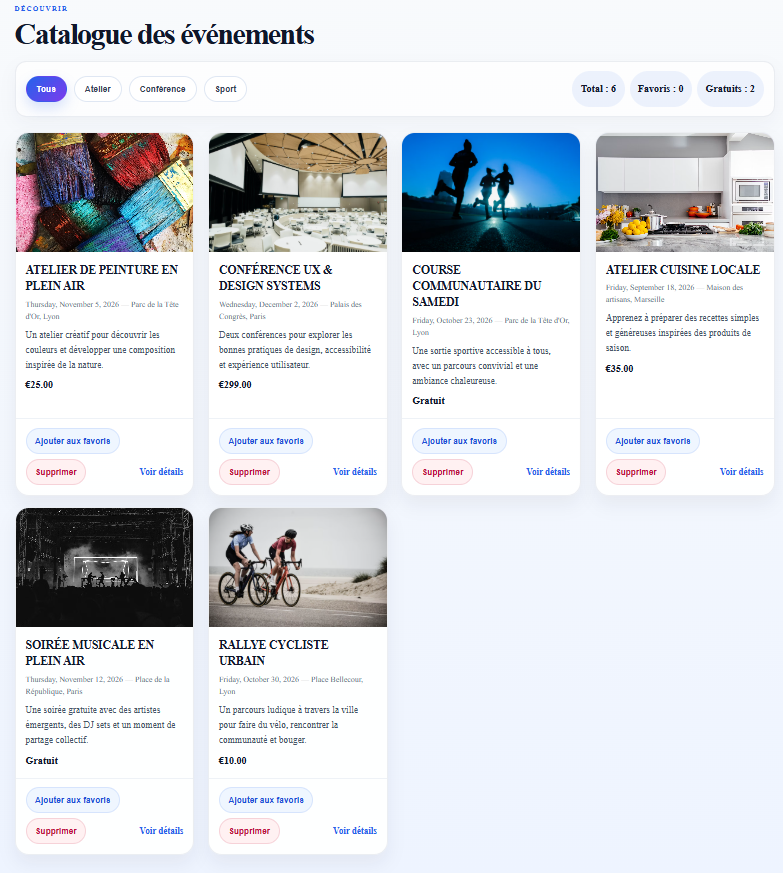
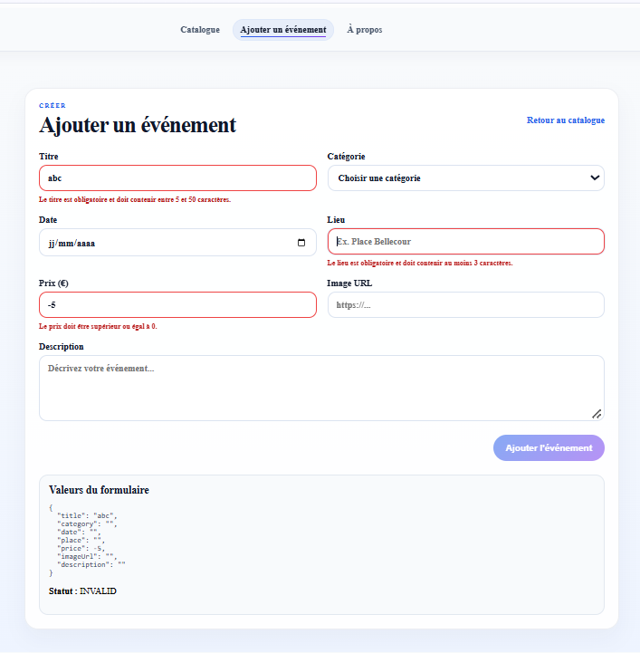

# EventhubSirine

This project was generated using [Angular CLI](https://github.com/angular/angular-cli) version 21.2.24.

## Development server

To start a local development server, run:

# EventHub — Catalogue d'événements (Angular 21, Standalone)

Description
-----------
EventHub est une mini-application front-end Angular 21 (architecture standalone) présentant un catalogue d'événements. L'application fonctionne entièrement côté client — les données sont stockées en dur dans `src/app/models/event.model.ts`.

Versions
--------
- Angular: 21 (standalone components)
- Node / npm: compatible avec le projet (v16+ recommandé)

Installation & lancement
------------------------
1. Installer les dépendances:

```bash
npm install
```

2. Lancer l'application en développement:

```bash
npm start
```

3. Ouvrir `http://localhost:4200`.

Structure principale
-------------------
- `src/app/models/event.model.ts`: interface `EventItem` et tableau de données `EVENTS`.
- `src/app/components/header`: composant `Header` avec navigation (`routerLink`).
- `src/app/components/event-list`: composant parent `EventList` (standalone) — affiche la grille, filtre par catégorie, gère les favoris via `signal()`.
- `src/app/components/event-card`: composant enfant `EventCard` (standalone) — reçoit un `EventItem` via `input.required<EventItem>()`, reçoit un `input<boolean>()` pour l'état favoris et émet `(toggleFavorite)` via `output<void>()`.
- `src/app/components/event-details`: composant `EventDetails` (standalone) — reçoit l'`id` route via `input()` (grâce à `withComponentInputBinding()`), recherche l'événement et affiche les détails ou un message d'erreur.
- `src/app/components/about`: page `About` chargée en lazy loading via `loadComponent()`.
- `src/app/components/not-found`: page 404.
- `src/app/app.routes.ts`: définition des routes et lazy-loading.

Principales fonctionnalités
---------------------------
- Composants standalone Angular 21.
- Gestion d'état légère avec `signal()`, `computed()`, `update()`.
- Control flow moderne: `@for` avec `track`, `@empty`, `@if/@else`.
- Communication parent/enfant via `input()`/`output()`.
- Routage moderne avec `provideRouter(routes, withComponentInputBinding())` pour lier les params de route aux `input()` des composants.

Utilisation technique
---------------------
- Filtrage des événements: `selectedCategory` est un `signal<string|null>`; `filteredEvents` est un `computed()`.
- Favoris: stockés en tant que tableau d'IDs dans un `signal<string[]>`; modification via `update()`.
- Détails d'un événement: `EventDetails` lit l'`id` via `input()` et récupère l'événement à partir du tableau `EVENTS`.

Captures d'écran
----------------
### Liste des événements avec compteurs


### Formulaire de création avec validations


Bonnes pratiques & extensions possibles
--------------------------------------
- Remplacer les données en dur par une API REST ultérieurement.
- Persister les favoris dans `localStorage` ou via un service.
- Ajouter des tests unitaires pour les composants et la logique des signaux.

Licence
-------
Projet d'exemple personnel.
